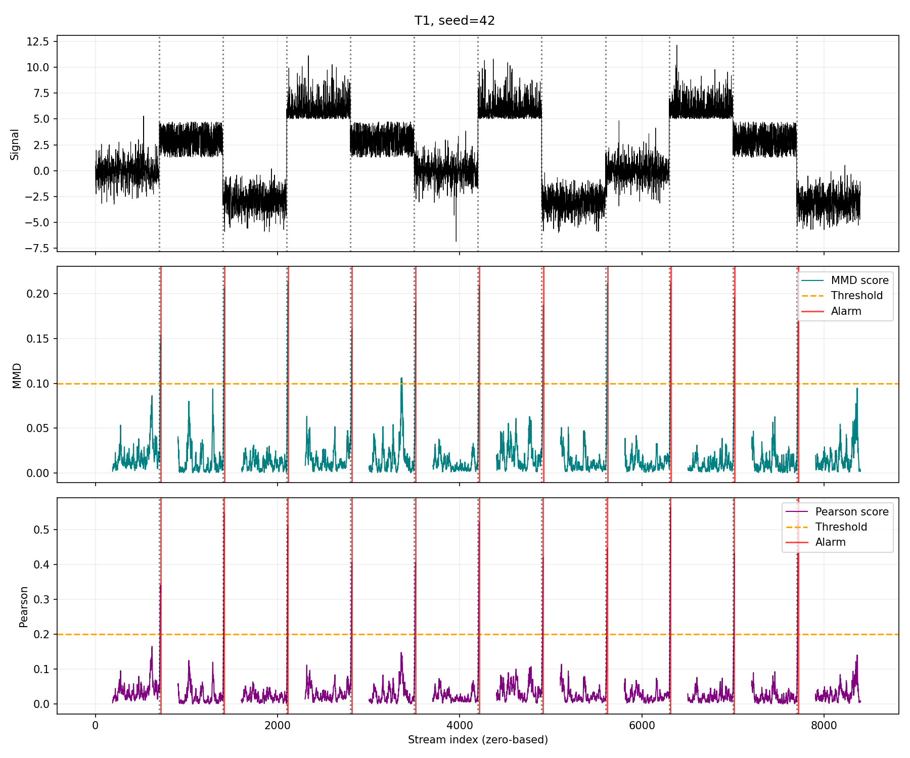
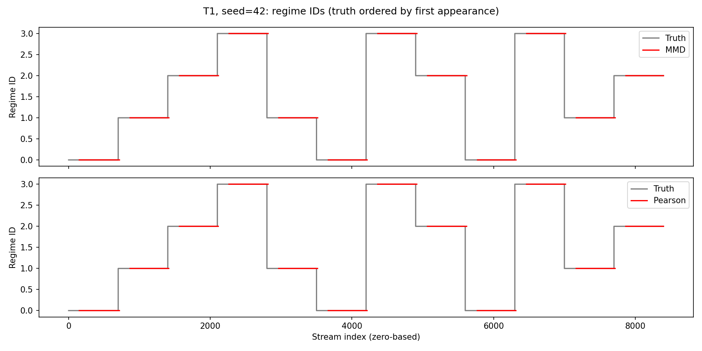
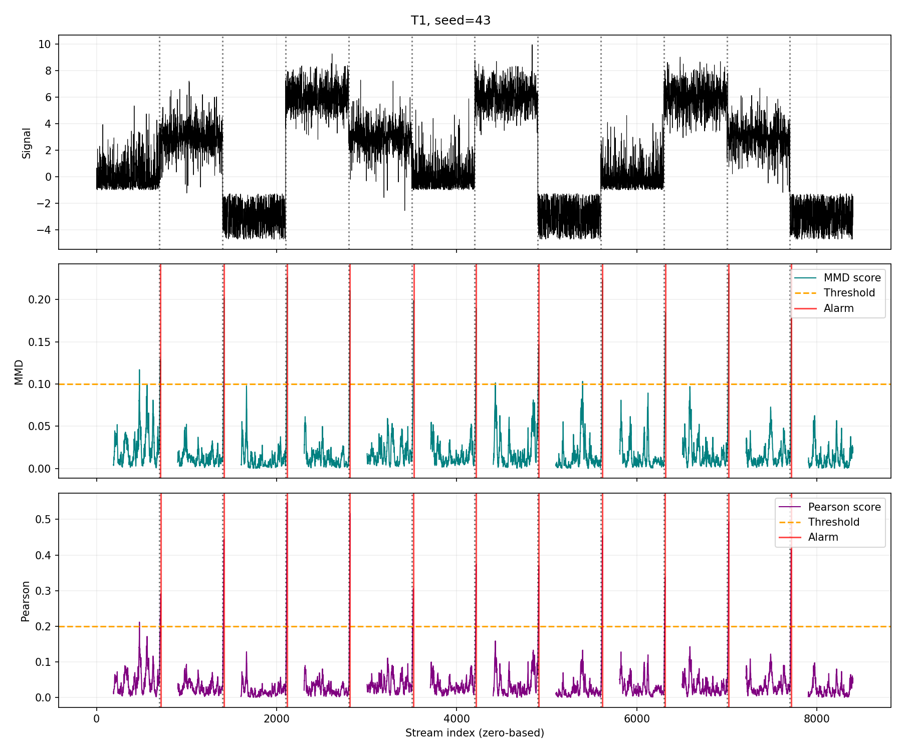
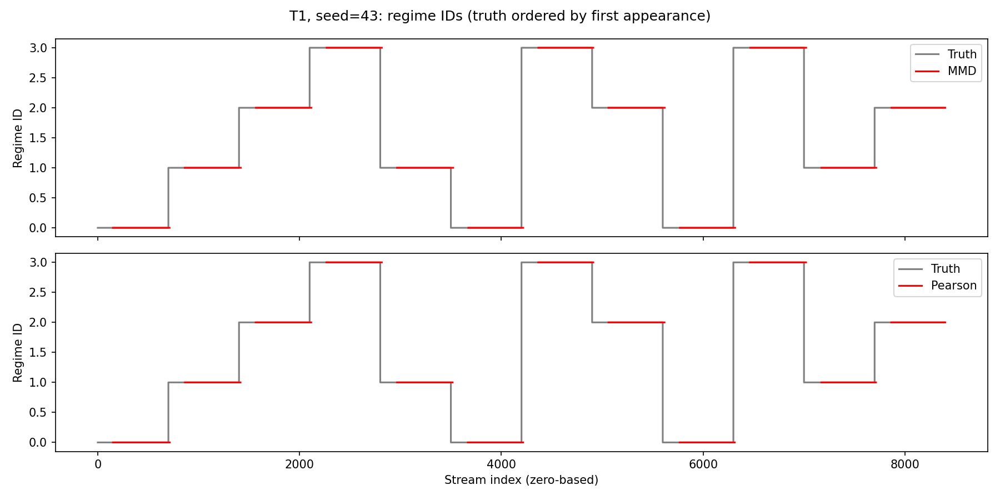
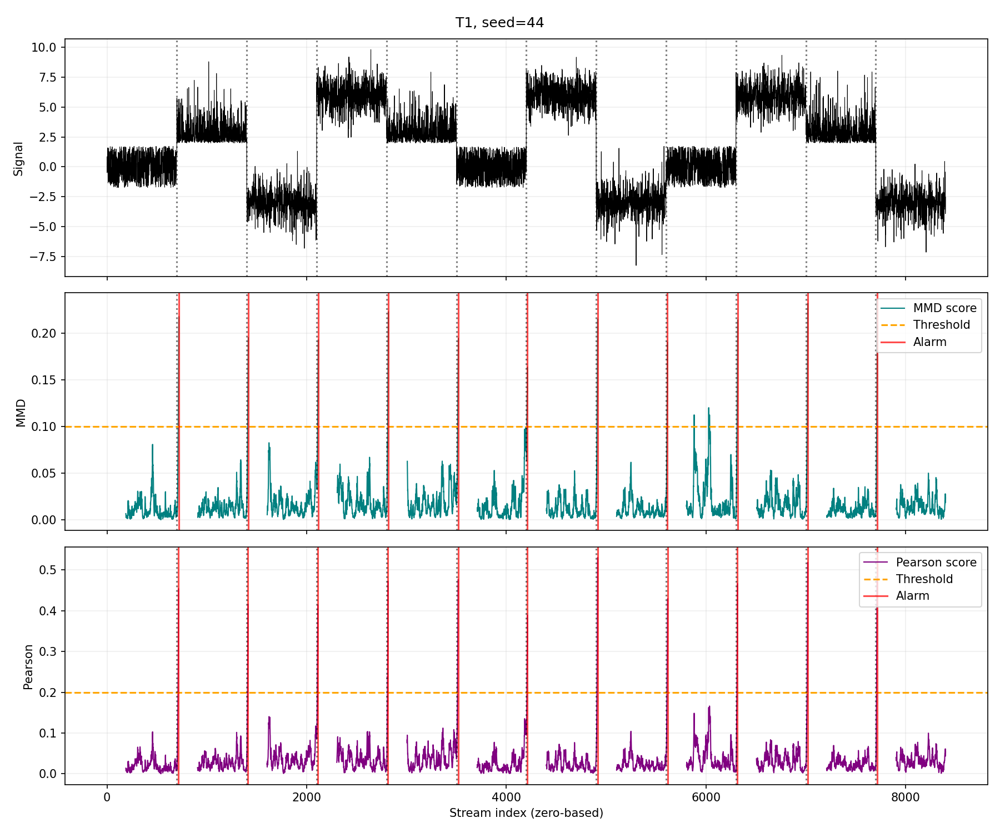

# T1: individual seed results

Both models use the same stream for each seed and the shared evaluator. Delay is measured at confirmed alarms; assignment is scored when the decision becomes available.

## Seed 42

Alarm tolerance: **46 samples** (inclusive).

| True regime | Distribution | Population mean | Population std |
|---|---|---:|---:|
| 1 | Laplace | 0 | 1 |
| 2 | Uniform | 3 | 1 |
| 3 | Gaussian | -3 | 1 |
| 4 | Exponential | 6 | 1 |

MMD: n=150, m=40, k_conf=6, gamma=0.1, factor=1.0, dynamic_gamma=True, eta=0.1, nu=0.63.

Pearson: n=150, m=40, k_conf=6, gamma=0.1, factor=1.0, dynamic_gamma=True, eta=0.2, nu=0.7, reg_lambda=0.1, normalize_distance=False.

| Metric | MMD | Pearson |
|---|---:|---:|
| Detected changes | 11/11 (100.0%) | 11/11 (100.0%) |
| False alarms | 0 | 0 |
| Mean detection delay (samples) | 16.45 | 14.64 |
| First-encounter discovery | 3/3 (100.0%) | 3/3 (100.0%) |
| Return-episode assignment | 8/8 (100.0%) | 8/8 (100.0%) |

## Seed 43

Alarm tolerance: **46 samples** (inclusive).

| True regime | Distribution | Population mean | Population std |
|---|---|---:|---:|
| 1 | Exponential | 0 | 1 |
| 2 | Laplace | 3 | 1 |
| 3 | Uniform | -3 | 1 |
| 4 | Gaussian | 6 | 1 |

MMD: n=150, m=40, k_conf=6, gamma=0.1, factor=1.0, dynamic_gamma=True, eta=0.1, nu=0.63.

Pearson: n=150, m=40, k_conf=6, gamma=0.1, factor=1.0, dynamic_gamma=True, eta=0.2, nu=0.7, reg_lambda=0.1, normalize_distance=False.

| Metric | MMD | Pearson |
|---|---:|---:|
| Detected changes | 11/11 (100.0%) | 11/11 (100.0%) |
| False alarms | 0 | 0 |
| Mean detection delay (samples) | 16.55 | 14.82 |
| First-encounter discovery | 3/3 (100.0%) | 3/3 (100.0%) |
| Return-episode assignment | 8/8 (100.0%) | 8/8 (100.0%) |

## Seed 44

Alarm tolerance: **46 samples** (inclusive).

| True regime | Distribution | Population mean | Population std |
|---|---|---:|---:|
| 1 | Uniform | 0 | 1 |
| 2 | Exponential | 3 | 1 |
| 3 | Laplace | -3 | 1 |
| 4 | Gaussian | 6 | 1 |

MMD: n=150, m=40, k_conf=6, gamma=0.1, factor=1.0, dynamic_gamma=True, eta=0.1, nu=0.63.

Pearson: n=150, m=40, k_conf=6, gamma=0.1, factor=1.0, dynamic_gamma=True, eta=0.2, nu=0.7, reg_lambda=0.1, normalize_distance=False.

| Metric | MMD | Pearson |
|---|---:|---:|
| Detected changes | 11/11 (100.0%) | 11/11 (100.0%) |
| False alarms | 0 | 0 |
| Mean detection delay (samples) | 16.18 | 14.55 |
| First-encounter discovery | 3/3 (100.0%) | 3/3 (100.0%) |
| Return-episode assignment | 8/8 (100.0%) | 8/8 (100.0%) |

## Aggregate over all seeds

| Metric | MMD | Pearson |
|---|---:|---:|
| Detected changes | 33/33 (100.0%) | 33/33 (100.0%) |
| False alarms | 0 | 0 |
| Mean detection delay (samples) | 16.39 | 14.67 |
| First-encounter discovery | 9/9 (100.0%) | 9/9 (100.0%) |
| Return-episode assignment | 24/24 (100.0%) | 24/24 (100.0%) |
