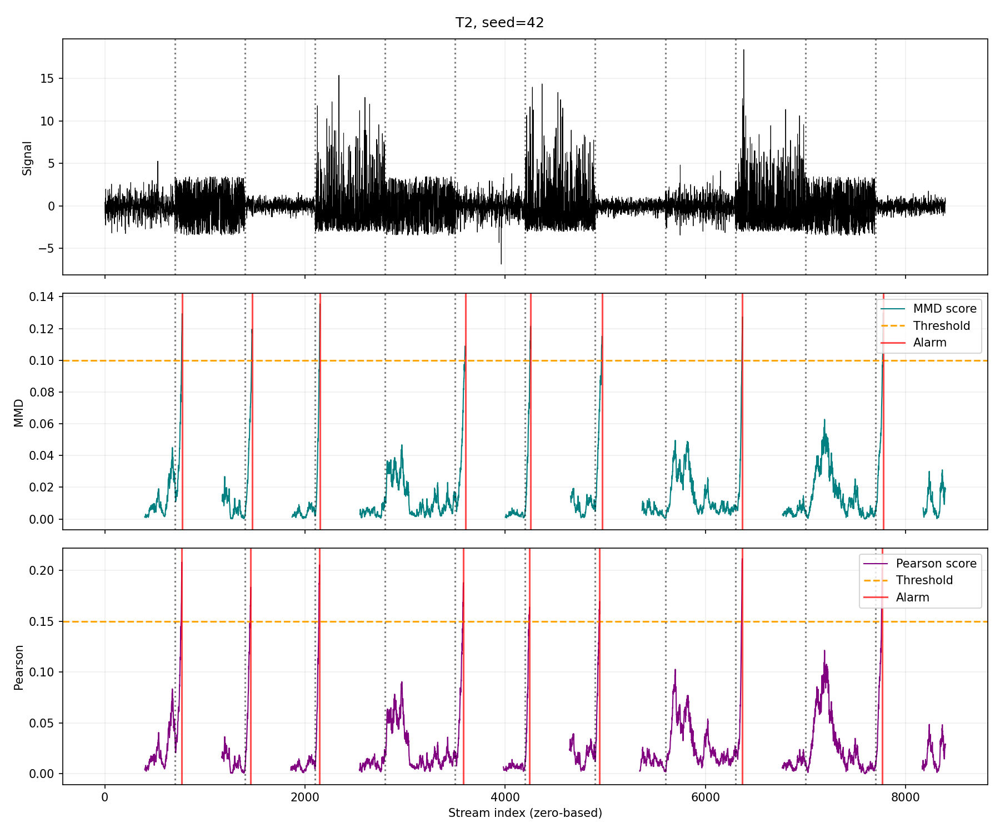
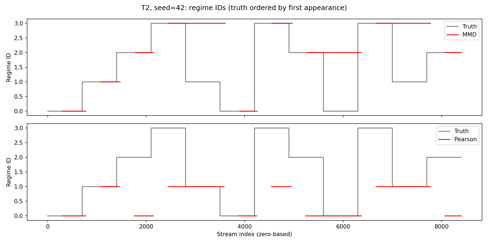
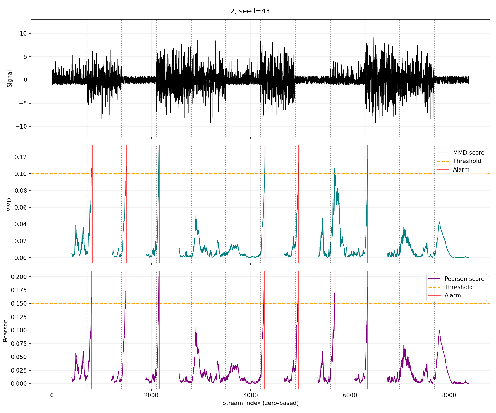
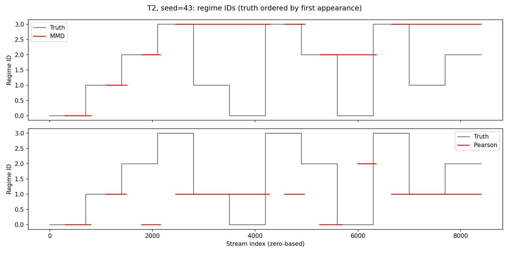
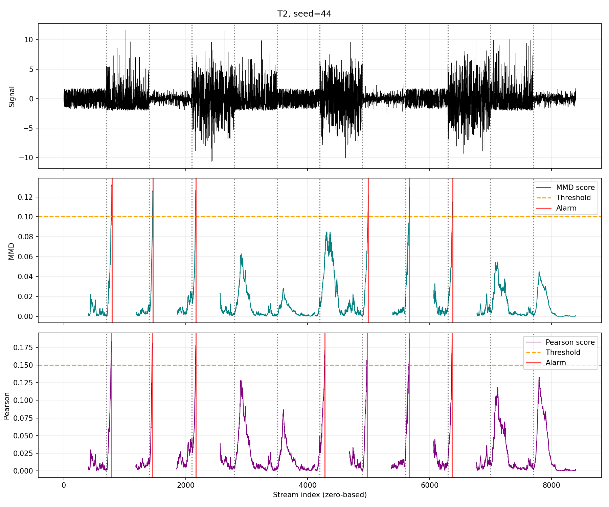
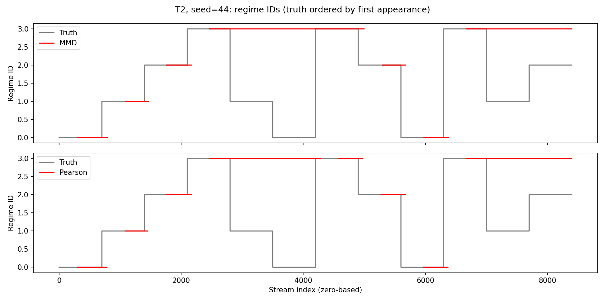

# T2: individual seed results

Both models use the same stream for each seed and the shared evaluator. Delay is measured at confirmed alarms; assignment is scored when the decision becomes available.

## Seed 42

Alarm tolerance: **106 samples** (inclusive).

| True regime | Distribution | Population mean | Population std |
|---|---|---:|---:|
| 1 | Laplace | 0 | 1 |
| 2 | Uniform | 0 | 2 |
| 3 | Gaussian | 0 | 0.5 |
| 4 | Exponential | 0 | 3 |

MMD: n=300, m=100, k_conf=6, gamma=0.1, factor=1.0, dynamic_gamma=True, eta=0.1, nu=0.99.

Pearson: n=300, m=100, k_conf=6, gamma=0.1, factor=1.0, dynamic_gamma=True, eta=0.15, nu=0.15, reg_lambda=0.1, normalize_distance=False.

| Metric | MMD | Pearson |
|---|---:|---:|
| Detected changes | 8/11 (72.7%) | 8/11 (72.7%) |
| False alarms | 0 | 0 |
| Mean detection delay (samples) | 70.12 | 59.25 |
| First-encounter discovery | 3/3 (100.0%) | 1/3 (33.3%) |
| Return-episode assignment | 5/8 (62.5%) | 1/8 (12.5%) |

## Seed 43

Alarm tolerance: **106 samples** (inclusive).

| True regime | Distribution | Population mean | Population std |
|---|---|---:|---:|
| 1 | Exponential | 0 | 1 |
| 2 | Laplace | 0 | 2 |
| 3 | Uniform | 0 | 0.5 |
| 4 | Gaussian | 0 | 3 |

MMD: n=300, m=100, k_conf=6, gamma=0.1, factor=1.0, dynamic_gamma=True, eta=0.1, nu=0.99.

Pearson: n=300, m=100, k_conf=6, gamma=0.1, factor=1.0, dynamic_gamma=True, eta=0.15, nu=0.15, reg_lambda=0.1, normalize_distance=False.

| Metric | MMD | Pearson |
|---|---:|---:|
| Detected changes | 6/11 (54.5%) | 7/11 (63.6%) |
| False alarms | 0 | 0 |
| Mean detection delay (samples) | 79.17 | 74.57 |
| First-encounter discovery | 3/3 (100.0%) | 1/3 (33.3%) |
| Return-episode assignment | 3/8 (37.5%) | 0/8 (0.0%) |

## Seed 44

Alarm tolerance: **106 samples** (inclusive).

| True regime | Distribution | Population mean | Population std |
|---|---|---:|---:|
| 1 | Uniform | 0 | 1 |
| 2 | Exponential | 0 | 2 |
| 3 | Laplace | 0 | 0.5 |
| 4 | Gaussian | 0 | 3 |

MMD: n=300, m=100, k_conf=6, gamma=0.1, factor=1.0, dynamic_gamma=True, eta=0.1, nu=0.99.

Pearson: n=300, m=100, k_conf=6, gamma=0.1, factor=1.0, dynamic_gamma=True, eta=0.15, nu=0.15, reg_lambda=0.1, normalize_distance=False.

| Metric | MMD | Pearson |
|---|---:|---:|
| Detected changes | 6/11 (54.5%) | 7/11 (63.6%) |
| False alarms | 0 | 0 |
| Mean detection delay (samples) | 75.67 | 70.14 |
| First-encounter discovery | 3/3 (100.0%) | 3/3 (100.0%) |
| Return-episode assignment | 3/8 (37.5%) | 4/8 (50.0%) |

## Aggregate over all seeds

| Metric | MMD | Pearson |
|---|---:|---:|
| Detected changes | 20/33 (60.6%) | 22/33 (66.7%) |
| False alarms | 0 | 0 |
| Mean detection delay (samples) | 74.50 | 67.59 |
| First-encounter discovery | 9/9 (100.0%) | 5/9 (55.6%) |
| Return-episode assignment | 11/24 (45.8%) | 5/24 (20.8%) |
