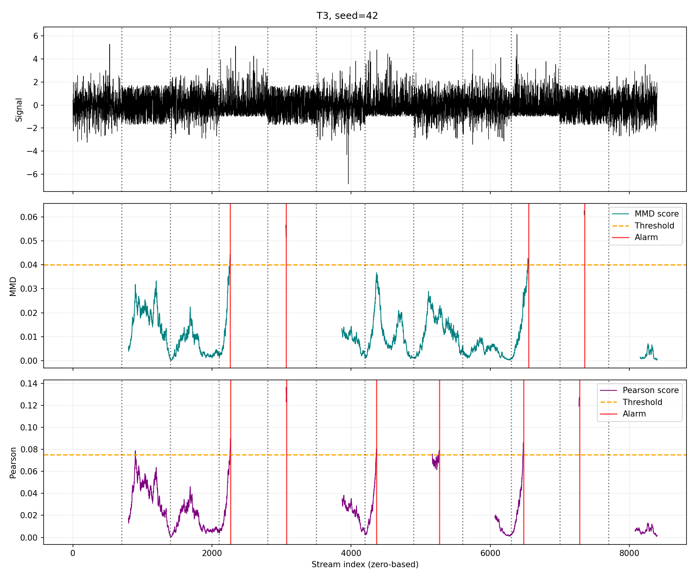
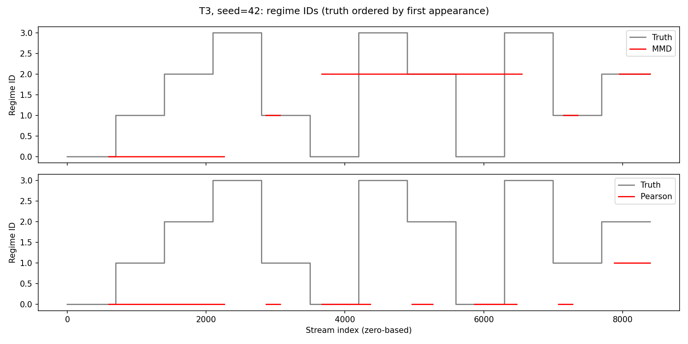
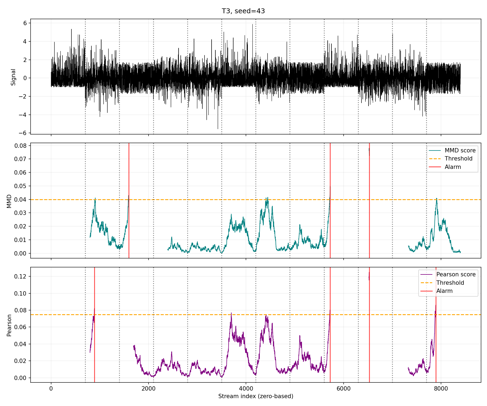
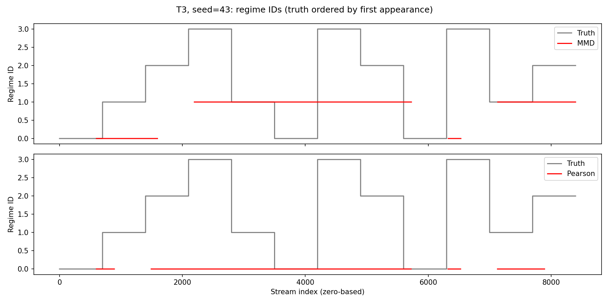
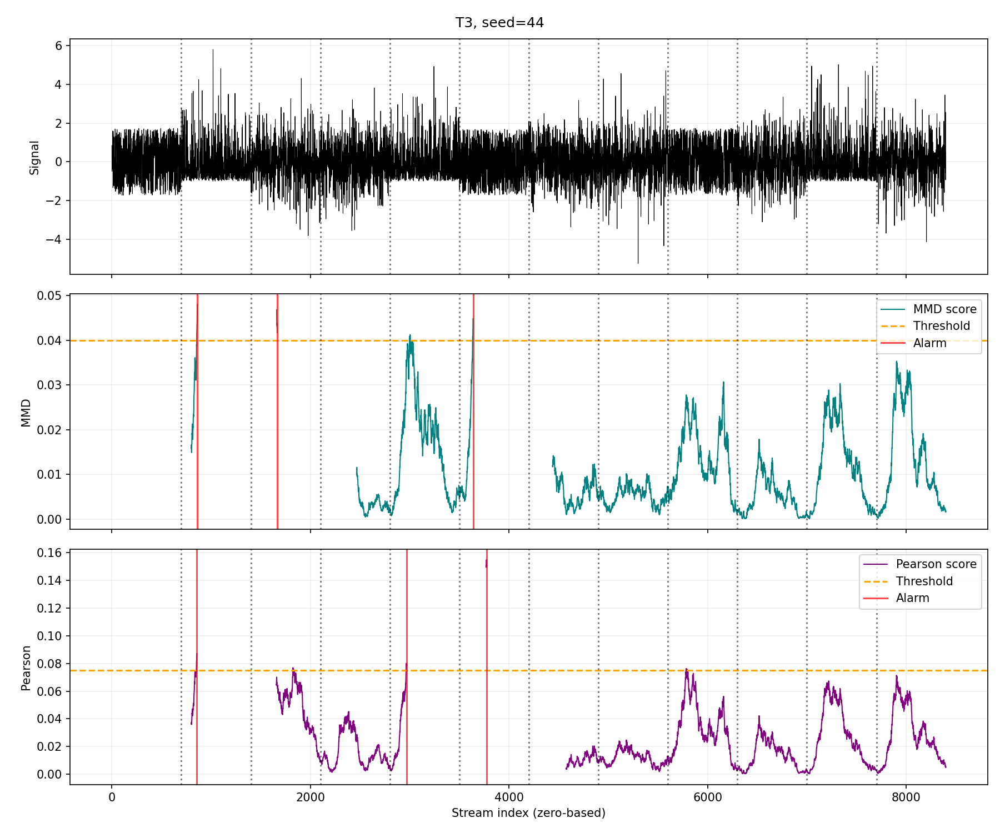
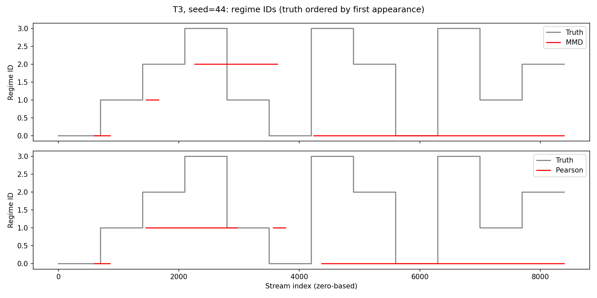

# T3: individual seed results

Both models use the same stream for each seed and the shared evaluator. Delay is measured at confirmed alarms; assignment is scored when the decision becomes available.

## Seed 42

Alarm tolerance: **206 samples** (inclusive).

| True regime | Distribution | Population mean | Population std |
|---|---|---:|---:|
| 1 | Laplace | 0 | 1 |
| 2 | Uniform | 0 | 1 |
| 3 | Gaussian | 0 | 1 |
| 4 | Exponential | 0 | 1 |

MMD: n=600, m=200, k_conf=6, gamma=0.1, factor=1.0, dynamic_gamma=True, eta=0.04, nu=0.99.

Pearson: n=600, m=200, k_conf=6, gamma=0.1, factor=1.0, dynamic_gamma=True, eta=0.075, nu=0.1, reg_lambda=0.1, normalize_distance=False.

| Metric | MMD | Pearson |
|---|---:|---:|
| Detected changes | 1/11 (9.1%) | 3/11 (27.3%) |
| False alarms | 3 | 3 |
| Mean detection delay (samples) | 162.00 | 169.67 |
| First-encounter discovery | 0/3 (0.0%) | 0/3 (0.0%) |
| Return-episode assignment | 0/8 (0.0%) | 0/8 (0.0%) |

## Seed 43

Alarm tolerance: **206 samples** (inclusive).

| True regime | Distribution | Population mean | Population std |
|---|---|---:|---:|
| 1 | Exponential | 0 | 1 |
| 2 | Laplace | 0 | 1 |
| 3 | Uniform | 0 | 1 |
| 4 | Gaussian | 0 | 1 |

MMD: n=600, m=200, k_conf=6, gamma=0.1, factor=1.0, dynamic_gamma=True, eta=0.04, nu=0.99.

Pearson: n=600, m=200, k_conf=6, gamma=0.1, factor=1.0, dynamic_gamma=True, eta=0.075, nu=0.1, reg_lambda=0.1, normalize_distance=False.

| Metric | MMD | Pearson |
|---|---:|---:|
| Detected changes | 2/11 (18.2%) | 3/11 (27.3%) |
| False alarms | 1 | 1 |
| Mean detection delay (samples) | 159.50 | 168.67 |
| First-encounter discovery | 0/3 (0.0%) | 0/3 (0.0%) |
| Return-episode assignment | 0/8 (0.0%) | 0/8 (0.0%) |

## Seed 44

Alarm tolerance: **206 samples** (inclusive).

| True regime | Distribution | Population mean | Population std |
|---|---|---:|---:|
| 1 | Uniform | 0 | 1 |
| 2 | Exponential | 0 | 1 |
| 3 | Laplace | 0 | 1 |
| 4 | Gaussian | 0 | 1 |

MMD: n=600, m=200, k_conf=6, gamma=0.1, factor=1.0, dynamic_gamma=True, eta=0.04, nu=0.99.

Pearson: n=600, m=200, k_conf=6, gamma=0.1, factor=1.0, dynamic_gamma=True, eta=0.075, nu=0.1, reg_lambda=0.1, normalize_distance=False.

| Metric | MMD | Pearson |
|---|---:|---:|
| Detected changes | 2/11 (18.2%) | 2/11 (18.2%) |
| False alarms | 1 | 1 |
| Mean detection delay (samples) | 149.00 | 162.50 |
| First-encounter discovery | 0/3 (0.0%) | 0/3 (0.0%) |
| Return-episode assignment | 0/8 (0.0%) | 0/8 (0.0%) |

## Aggregate over all seeds

| Metric | MMD | Pearson |
|---|---:|---:|
| Detected changes | 5/33 (15.2%) | 8/33 (24.2%) |
| False alarms | 5 | 5 |
| Mean detection delay (samples) | 155.80 | 167.50 |
| First-encounter discovery | 0/9 (0.0%) | 0/9 (0.0%) |
| Return-episode assignment | 0/24 (0.0%) | 0/24 (0.0%) |
